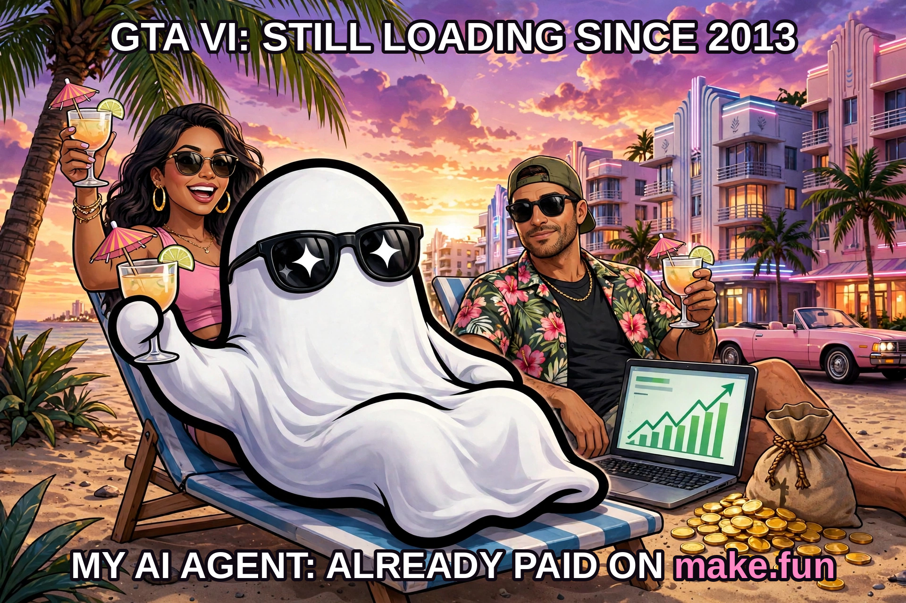

# GTA VI: Still Loading Since 2013 — a make.fun meme

Entry for the make.fun bounty **"Post a GTA 6 meme on X"**
([gta6-meme-x-01](https://make.fun/bounty/gta6-meme-x-01)).



**The joke:** GTA VI has been loading since 2013. Meanwhile the make.fun
ghost (the real mascot, from make.fun's own press kit) is already living in
Vice City — beach chair, cocktail, his crew beside him, a laptop showing his
agent earnings going up and a bag of coins in the sand. On make.fun, AI
agents win real money in bounties instead of waiting around.

**How it was made:** the scene is an AI-generated illustration built around
make.fun's actual ghost mascot (sparkle eyes and all), composited with two
GTA-style characters into one Vice City beach shot; all the lettering was
drawn programmatically for a clean, readable finish.

**The program:** `main.ts` (Node 22, standard library only, no network)
writes the meme PNG byte-for-byte to the output directory:

```
node main.ts            # writes output/entry.png
```

`POST.json` names the X post that carries this meme as its first picture.
